# Bodexa: sistema de inventario, ventas y alertas de stock para bodegas

**Institución:** [PENDIENTE]

**Curso:** Técnicas de Programación [confirmar denominación oficial]

**Grupo:** [PENDIENTE]

**Integrantes:** [PENDIENTE: nombres completos y códigos]

**Docente:** [PENDIENTE]

**Fecha de entrega:** [PENDIENTE]

**Repositorio GitHub:** [PENDIENTE: URL pública o accesible al docente]

Documento preparado a partir de la versión ejecutable de Entrega3. Completar los datos administrativos, la validación del contexto real y los aportes del equipo antes de entregar. El nombre Bodexa es provisional hasta confirmación del equipo.

## 1. Resumen del proyecto

Bodexa es una aplicación de escritorio desarrollada en Java para apoyar el control de productos y ventas de una bodega pequeña. El problema abordado es la dificultad de mantener actualizadas las existencias cuando las ventas se registran manualmente y no existe un aviso oportuno de productos próximos a agotarse. Los usuarios considerados son el propietario o encargado que administra el inventario y registra las ventas desde un equipo local.

La solución permite registrar categorías y productos, consultar existencias, buscar y modificar información, registrar ventas con sus detalles, reponer unidades y revisar el historial. Cada venta valida las cantidades disponibles, conserva el precio utilizado y descuenta las unidades correspondientes. Cuando el stock es inferior a cinco unidades se genera una alerta pendiente; al reponer hasta cinco o más unidades, se atiende automáticamente.

La implementación utiliza clases encapsuladas, colecciones, sobrecarga de métodos, una interfaz de persistencia y manejo de excepciones. El modo de archivo local fue compilado y sometido a veintiocho pruebas automatizadas satisfactorias. También se verificaron cuatro condiciones del esquema SQL Server. El adaptador JDBC está desarrollado, pero su integración permanece pendiente de habilitar TCP/IP en el servidor. La versión resultante demuestra el flujo de inventario y ventas con datos ficticios; la validación del problema en una bodega concreta queda pendiente de documentar.

## 2. Descripción del problema

### Contexto y usuarios

El escenario propuesto es una bodega pequeña que vende productos por unidades y opera con un encargado desde un computador. Si las ventas y las existencias se anotan por separado, el registro de inventario puede diferir de lo físicamente disponible. Los usuarios directamente involucrados son el propietario y el encargado de ventas. Los clientes son beneficiarios indirectos de una consulta más clara de disponibilidad.

Esta descripción es una hipótesis de trabajo contextual, no un diagnóstico de una empresa identificada. Antes de presentar el problema como real observado, el equipo debe completar el anexo de validación mediante una conversación u observación en una bodega. No se realizaron entrevistas ni se midieron pérdidas económicas en esta preparación.

### Causas y consecuencias

El diagrama de Ishikawa organiza las causas propuestas del desajuste entre ventas e inventario. Estas causas deben contrastarse con la bodega seleccionada.

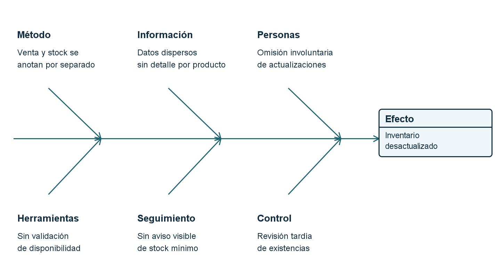

| Grupo de causas | Causa propuesta | Consecuencia probable |
|---|---|---|
| Método | Venta e inventario se actualizan en momentos diferentes | Diferencias entre stock registrado y disponible |
| Información | Registros dispersos o sin detalle por producto | Dificultad para reconstruir cantidades vendidas |
| Personas | Omisión involuntaria de una actualización | Existencias desactualizadas |
| Herramientas | Ausencia de validación de disponibilidad | Intentos de vender más unidades de las existentes |
| Seguimiento | Ausencia de un umbral de reposición visible | Identificación tardía de productos escasos |

La solución se justifica porque vincula en una misma operación la venta, sus líneas y el descuento de existencias. Una alerta orienta al encargado a revisar la reposición; no realiza compras automáticamente ni garantiza por sí sola que nunca exista desabastecimiento.

### Antecedentes relacionados

**Odoo Inventory:** su documentación de reglas de reabastecimiento explica el uso de cantidades mínimas y máximas para controlar existencias previstas, con modalidades de reposición manual y automática (Odoo, s. f.). Este antecedente respalda el uso de un umbral para identificar necesidades de reposición. Bodexa adopta una versión simplificada: alerta sobre stock actual menor que cinco, sin proyecciones ni órdenes de compra automáticas.

**ERPNext Stock Ledger:** registra movimientos de entrada y salida asociados a compras, ventas y transferencias, conservando cantidades y valores de inventario (Frappe Technologies, 2026). Este antecedente muestra la importancia de vincular las operaciones comerciales con el stock. Bodexa conserva detalles de ventas y unidades vendidas; un registro completo de todos los movimientos de entrada y salida queda como mejora futura.

Como soporte de implementación se usan las transacciones JDBC, que permiten confirmar o revertir conjuntamente cambios relacionados (Oracle, s. f.-a), y las restricciones CHECK y UNIQUE de SQL Server (Microsoft, s. f.-a). Estas referencias son antecedentes documentales; no sustituyen la validación de campo en una bodega específica.

## 3. Objetivos y alcance

### 3.1 Objetivo general

Desarrollar un sistema orientado a objetos en Java que permita gestionar productos y ventas de una bodega pequeña, mantener actualizadas sus existencias y señalar los productos cuyo stock sea inferior a cinco unidades.

### 3.2 Objetivos específicos

1. Definir los requerimientos y reglas de registro de productos, ventas, reposiciones y alertas para el escenario seleccionado.
2. Diseñar clases y relaciones que representen el inventario, los detalles de venta y los mecanismos de persistencia.
3. Implementar una interfaz de escritorio con validaciones de códigos, precios, cantidades y disponibilidad.
4. Conservar los datos de las operaciones y evitar que una venta inválida deje descuentos parciales de inventario.
5. Verificar el comportamiento mediante pruebas normales, inválidas, de persistencia y de recuperación ante fallos.

### 3.3 Alcance

Incluye categorías, productos, búsqueda por código o nombre, edición de nombre/precio/categoría, eliminación de productos sin ventas, ventas con varios productos, unidades vendidas por producto, reposición y alertas. El uso es local y monousuario. Todas las ventas se consideran a público general; no se almacenan datos personales de compradores.

El modo local conserva información en un archivo. Existe un adaptador SQL opcional con configuración pendiente de conexión. Los modos son independientes y no sincronizan datos.

### 3.4 Restricciones y limitaciones

- Los datos administrativos, la bodega concreta y las contribuciones del equipo aún deben completarse.
- La instalación SQL Server disponible no tiene TCP/IP habilitado. El usuario indicó conservar su configuración; la conexión JDBC no se validó.
- El umbral es fijo y común: stock menor que 5. No hay mínimos diferentes por producto.
- No hay pagos, devolución/anulación de ventas, comprobantes fiscales, correo a proveedores, clientes nominales, vencimientos ni lotes.
- Las reposiciones se reflejan en el stock, pero no cuentan con un historial independiente de entradas.
- El adaptador SQL guarda una instantánea completa en cada operación; está pensado para volúmenes pequeños y una única instancia, no para cajas concurrentes.
- La interfaz y el flujo de negocio están separados, pero EstadoBodega expone sus colecciones a los adaptadores; una mejora futura es restringir más ese acceso.

## 4. Descripción de la solución

Bodexa ofrece cuatro pestañas: Productos, Registrar venta, Alertas e Historial. El encargado crea categorías y productos, añade unidades al carrito, confirma la venta y consulta el stock restante. Para reponer un producto lo selecciona en Productos e indica la cantidad que ingresa.

Flujo principal: registro del producto -> selección y cantidades -> validación completa del carrito -> cálculo con precios del catálogo -> descuento de stock -> actualización de alertas -> persistencia conjunta -> mensaje de confirmación.

Reglas importantes: una cantidad debe ser positiva; nunca se permite stock negativo; exactamente 5 unidades no constituyen stock bajo; no se duplican alertas pendientes; modificar un precio no cambia ventas anteriores; productos con ventas no se eliminan; la confirmación de venta no representa un pago bancario.

## 5. Requerimientos funcionales

Los estados se refieren a la versión entregada. Implementado significa desarrollado y verificado en el modo local, salvo que se indique otro alcance.

| Código | Nombre | Descripción | Prioridad | Estado |
|---|---|---|---|---|
| RF01 | Categorías | Registrar categorías con nombre obligatorio y sin duplicados | Alta | Implementado |
| RF02 | Productos | Registrar código único, nombre, precio, stock inicial y categoría | Alta | Implementado |
| RF03 | Consulta | Listar productos y buscar por código exacto o parte del nombre | Alta | Implementado |
| RF04 | Edición | Modificar nombre, precio y categoría conservando el stock | Media | Implementado |
| RF05 | Eliminación | Eliminar productos sin ventas, conservando los historiales existentes | Media | Implementado |
| RF06 | Ventas | Registrar una venta con una o varias líneas y calcular su total | Alta | Implementado |
| RF07 | Consistencia | Descontar existencias, guardar detalles y rechazar cantidades inválidas sin cambios parciales | Alta | Implementado |
| RF08 | Alertas | Generar alerta al quedar por debajo de 5, incluso en el alta inicial | Alta | Implementado |
| RF09 | Reposición | Aumentar stock y atender alertas al recuperar 5 o más unidades | Alta | Implementado |
| RF10 | Historial | Consultar ventas, detalles y unidades acumuladas por producto | Alta | Implementado |
| RF11 | Persistencia local | Conservar información entre ejecuciones y bloquear una segunda instancia sobre el archivo | Alta | Implementado |
| RF12 | Persistencia SQL | Guardar las mismas entidades mediante JDBC y transacción SQL | Media | Parcial: código y esquema; integración JDBC pendiente |

Las funciones de correo, vencimientos y tickets del material original no forman parte del alcance final de esta versión; no se presentan como implementadas.

## 6. Historias de usuario y criterios de aceptación

**HU01 — Registro de productos (RF01, RF02).** Como encargado quiero registrar productos por categoría para consultar un catálogo organizado. Criterios: nombre no vacío; código positivo y único; precio positivo con hasta dos decimales; stock inicial no negativo; categoría existente. Con datos válidos se persiste el producto; con datos inválidos se informa el error. Estado: implementada.

**HU02 — Consulta y mantenimiento (RF03, RF04, RF05).** Como encargado quiero buscar y actualizar productos para mantener su información vigente. Criterios: búsqueda por nombre sin distinguir mayúsculas o por código; sin coincidencias se muestra una tabla vacía; edición conserva existencias; eliminación se rechaza cuando hay ventas relacionadas. Estado: implementada.

**HU03 — Venta consistente (RF06, RF07).** Como encargado quiero registrar los productos vendidos para descontarlos de inventario sin errores. Criterios: carrito no vacío; cantidades positivas; suma de líneas repetidas; ninguna cantidad supera el stock; total calculado con precios del catálogo; si alguna línea falla no se guarda la venta ni se descuenta otra línea; si falla la escritura se restaura el estado previo. Estado: implementada en modo local.

**HU04 — Aviso de escasez (RF08).** Como propietario quiero identificar productos próximos a agotarse para decidir su reposición. Criterios: pasar de 6 a 4 genera una alerta; exactamente 5 no genera alerta; pasar de 4 a 3 no duplica la alerta pendiente; un producto nuevo con stock 0 también la genera. Estado: implementada.

**HU05 — Reposición (RF09).** Como encargado quiero agregar las unidades recibidas para actualizar la disponibilidad. Criterios: cantidad positiva; reposición de 3 a 4 mantiene la alerta pendiente; de 4 a 5 la atiende; una nueva caída debajo de 5 genera una nueva alerta. Estado: implementada.

**HU06 — Seguimiento (RF10, RF11).** Como propietario quiero consultar ventas y unidades vendidas para conocer la salida de cada producto. Criterios: cada venta conserva fecha, nombre y precio histórico; modificar el precio del catálogo no cambia el total anterior; al reiniciar se mantienen ventas y stock; las reposiciones no aumentan el contador de unidades vendidas. Estado: implementada.

**HU07 — Base de datos opcional (RF12).** Como encargado quiero guardar la información en SQL Server para trabajar con una base relacional. Criterios: conexión configurable; escritura transaccional; rechazo de una segunda instancia; recarga consistente de detalles, stock y alertas. Estado: parcial; falta ejecutar el flujo completo mediante JDBC una vez habilitado TCP/IP.

## 7. Diseño del sistema

### 7.1 Diagrama de clases final

Los diagramas siguientes representan las clases y relaciones del código entregado. Se omiten getters triviales y componentes visuales para mantener legibilidad. La especificación editable completa está en `docs/DIAGRAMA_CLASES.puml`.

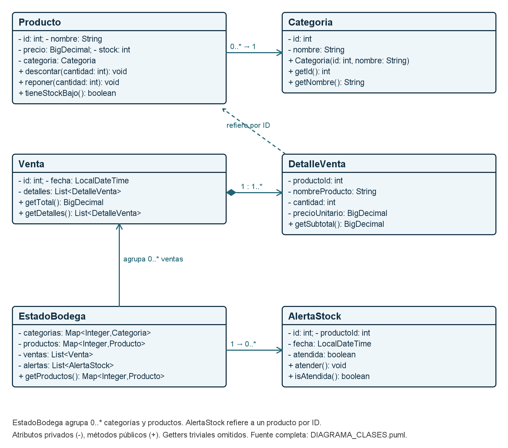

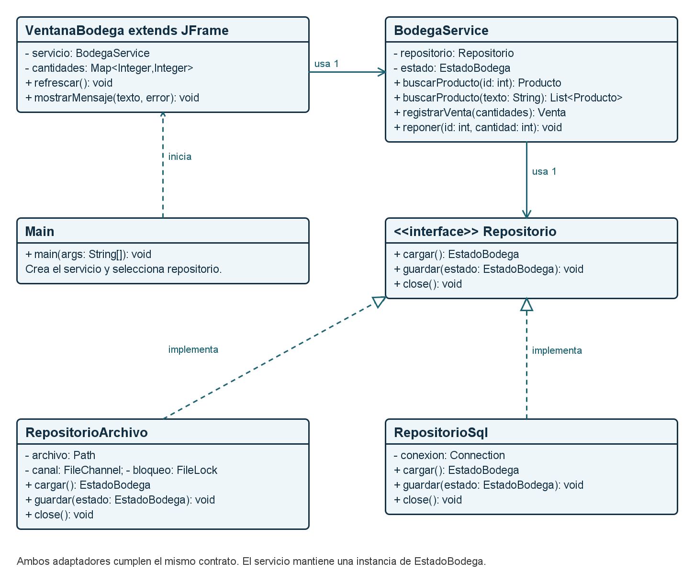

DetalleVenta y AlertaStock guardan identificadores de producto, no referencias persistentes al objeto Producto. Una venta contiene uno o más detalles. Cada producto pertenece a una categoría. La interfaz Repositorio permite sustituir el almacenamiento sin duplicar las reglas de negocio.

### 7.2 Responsabilidades

| Clase | Responsabilidad |
|---|---|
| Categoria | Identidad y nombre de una agrupación |
| Producto | Validación de datos, stock y operaciones de descuento/reposición |
| DetalleVenta | Cantidad y precio histórico; cálculo de subtotal |
| Venta | Identidad, fecha, detalles y cálculo del total |
| AlertaStock | Identidad, producto referido y estado pendiente/atendido |
| EstadoBodega | Agrupar categorías, productos, ventas y alertas para persistir |
| BodegaService | Validar y coordinar operaciones de negocio |
| RepositorioArchivo | Serializar y reemplazar atómicamente el archivo, con bloqueo |
| RepositorioSql | Cargar y guardar entidades SQL en una transacción |
| VentanaBodega | Presentar datos y recibir acciones del usuario |
| Main | Elegir repositorio e iniciar la ventana |

## 8. Implementación del sistema

El código requiere Java 17 y emplea Swing para la interfaz. Los paquetes son `bodexa.modelo`, `bodexa.servicio`, `bodexa.persistencia` y `bodexa.vista`; Main es el punto de entrada. El script compilar.ps1 genera un JAR ejecutable sin exigir un IDE específico.

**Encapsulamiento:** los atributos de Producto son privados. Las variaciones de stock se realizan mediante descontar y reponer, que validan las cantidades. Se usan constructores para establecer entidades válidas.

**Sobrecarga:** BodegaService define buscarProducto(int) y buscarProducto(String). Uno devuelve un producto por identificador y el otro una lista filtrada. No se confunde sobrecarga con sobrescritura.

**Abstracción y polimorfismo:** BodegaService utiliza la interfaz Repositorio. RepositorioArchivo y RepositorioSql implementan cargar y guardar con mecanismos diferentes. El servicio no necesita saber cuál fue seleccionado. También se sobrescribe toString en Producto y Categoria. La interfaz visual hereda de JFrame; no se introdujo una jerarquía artificial de tipos de producto.

**Colecciones:** LinkedHashMap organiza productos y categorías por código y acumula cantidades del carrito; ArrayList conserva ventas y alertas; List.copyOf protege las listas de detalles de Venta contra modificaciones externas.

**Importes:** BigDecimal evita errores de representación binaria de importes monetarios; se permiten dos decimales y se calculan subtotales desde cantidades enteras.

**Excepciones:** las reglas inválidas producen IllegalArgumentException; la vista presenta mensajes de validación. Las operaciones de archivo y JDBC propagan fallos al servicio. Si una modificación falla, se recarga el estado persistido para evitar descuentos parciales en memoria. Las pruebas incluyen un fallo de escritura simulado.

**Archivo local:** la serialización escribe primero un temporal y luego realiza un reemplazo atómico. Se bloquea la apertura simultánea del mismo archivo. El archivo debe permanecer en un sistema de archivos que admita esa operación.

**SQL:** utiliza PreparedStatement, columnas DECIMAL, claves foráneas y restricciones. Desactiva autoCommit, escribe el conjunto de datos y confirma mediante commit; ante error utiliza rollback. No hay triggers de descuento: la responsabilidad está centralizada en Java. Las tablas se crearon en BodexaT3; no se modificó MarketPERU.

## 9. Pruebas y resultados

Se ejecutaron 28 pruebas automatizadas del modelo, servicio y repositorio local. El registro completo del anexo contiene entrada, resultado esperado, resultado obtenido y estado. Las pruebas cubren altas, duplicados, campos vacíos, valores inválidos, búsquedas, ventas, stock, reposiciones, alertas, persistencia, conservación de precios históricos y recuperación ante fallo de escritura.

Resultado: 28 aprobadas. Este resultado corresponde al modo local y a las capas probadas; no se extiende automáticamente al adaptador JDBC ni equivale a una prueba de usabilidad con usuarios reales.

El script SQL produjo cuatro verificaciones satisfactorias: relaciones y escritura transaccional de ejemplo, rechazo de stock negativo, rechazo de alertas pendientes duplicadas y rollback sin datos residuales. El registro está en `docs/evidencias/pruebas_sql.txt`. Son verificaciones del esquema SQL mediante sqlcmd; no validan el flujo Java-SQL.

## 10. Evidencias de funcionamiento

Estas imágenes capturan los componentes Swing reales de la aplicación durante un escenario automatizado con datos ficticios. La herramienta invoca el servicio, refresca la ventana y captura sus componentes. No se presentan como pruebas manuales realizadas por integrantes del equipo.

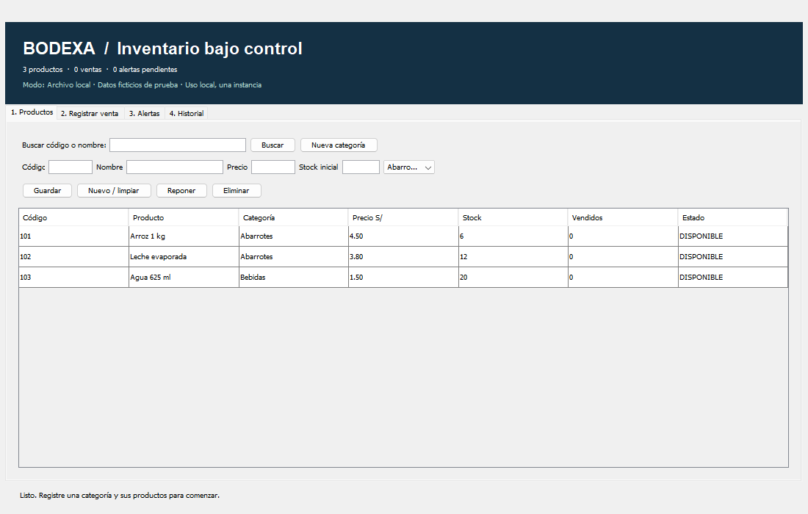

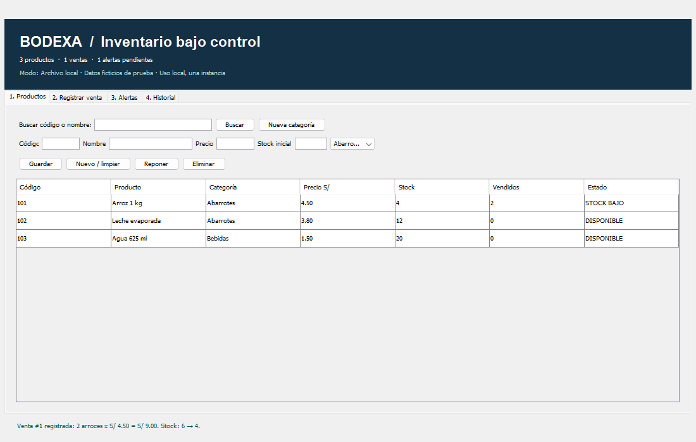

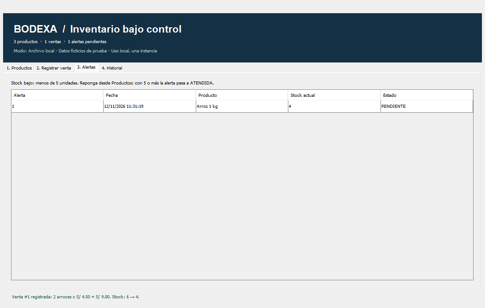

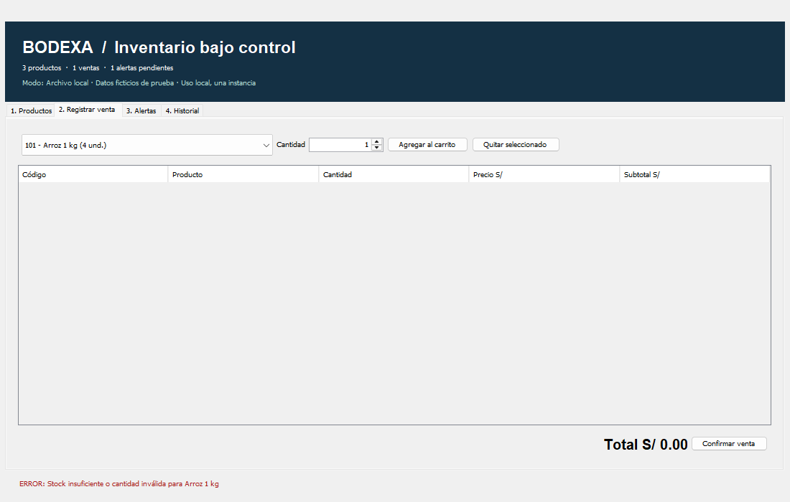

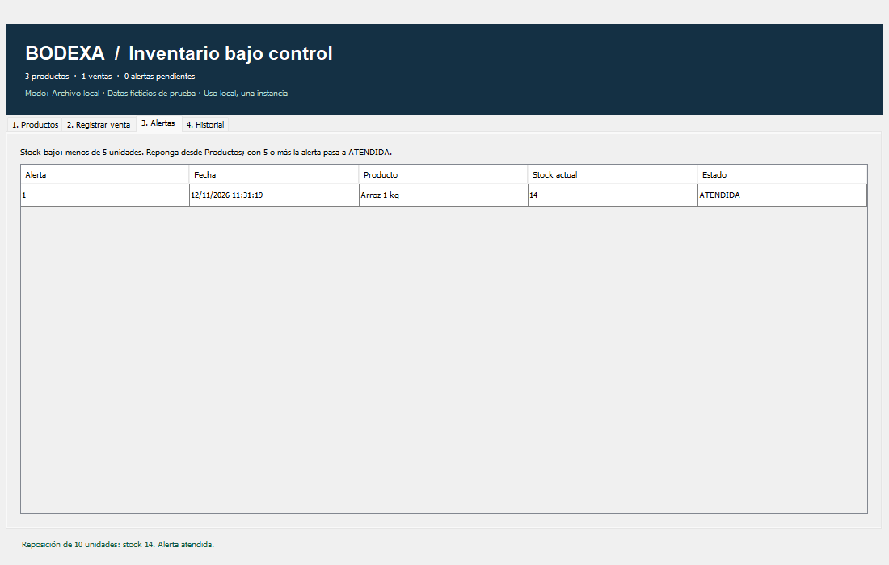

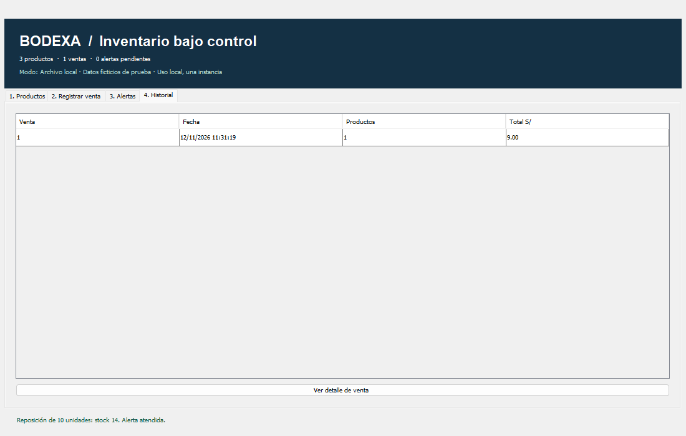

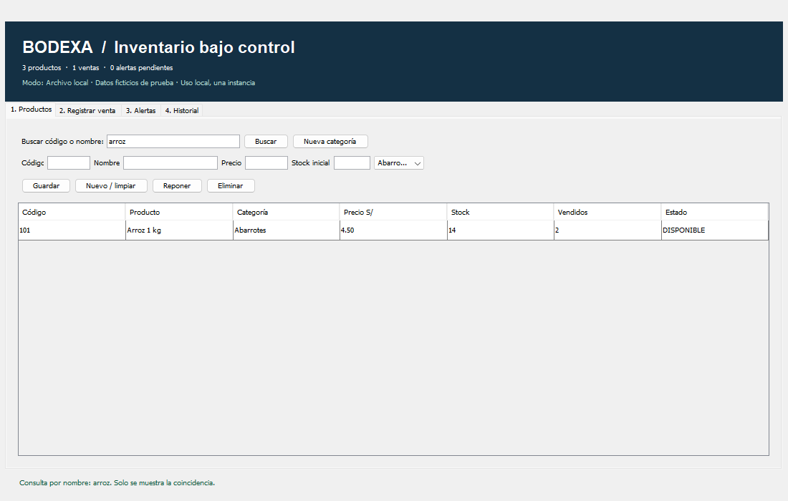

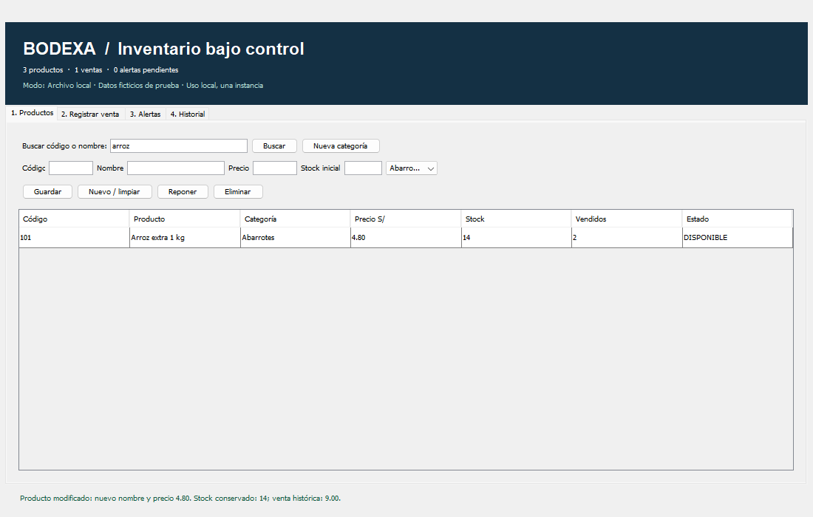

## 11. Trabajo colaborativo

**Repositorio:** [PENDIENTE: crear y pegar URL real]. No se creó un repositorio remoto en esta preparación porque faltan la cuenta, destino y datos del equipo. El entorno no tiene Git disponible en PATH.

**Integrantes y aportes efectivos:** [PENDIENTE]. Registrar solo trabajo realmente realizado, incluyendo revisión, comprensión, pruebas manuales y documentación. No atribuir automáticamente el código generado a una persona ni afirmar participación previa que no pueda sustentarse.

| Integrante | Responsabilidad asumida | Aporte realizado | Evidencia real |
|---|---|---|---|
| [PENDIENTE] | [PENDIENTE] | [PENDIENTE] | Enlace a commit o PR |

La versión se preparó con asistencia de una herramienta de IA a partir del material suministrado. El equipo debe revisar y comprender el resultado y aplicar las reglas de su curso sobre declaración de herramientas. Dificultades de coordinación y soluciones: [PENDIENTE: completar con hechos del equipo]. Las capturas de GitHub se añadirán cuando existan contribuciones reales.

## 12. Conclusiones

1. La versión local implementa el flujo de inventario, venta y alerta: una venta válida descuenta existencias y una inválida conserva el estado previo, según las pruebas ejecutadas.
2. La separación entre entidades, servicio, repositorios y vista permite explicar responsabilidades y aplicar encapsulamiento, sobrecarga, colecciones y polimorfismo de interfaz.
3. La persistencia local conserva el historial y permite ejecutar el producto sin depender de la configuración de SQL Server. El adaptador SQL queda parcialmente verificado.
4. Las pruebas de límites, duplicados y fallos de escritura muestran la importancia de comprobar escenarios inválidos además del funcionamiento normal. No se midió todavía el efecto del sistema en una bodega real.
5. Para completar la entrega académica faltan los datos institucionales, la validación del contexto, el repositorio y las evidencias reales de colaboración y sustentación.

## 13. Recomendaciones y mejoras futuras

Validar el contexto con una bodega y realizar una sesión de uso con el encargado. Habilitar TCP/IP cuando corresponda y completar pruebas de integración JDBC. En una siguiente versión, implementar movimientos de entrada con fecha y responsable, umbral por producto, anulaciones controladas, reportes y múltiples usuarios. Para más volumen, reemplazar las instantáneas SQL por operaciones incrementales y pruebas de concurrencia. Estas son mejoras propuestas, no funcionalidades ya completadas.

## 14. Referencias

Frappe Technologies. (2026, 26 de febrero). *Stock Ledger Report*. ERPNext Documentation. https://docs.frappe.io/erpnext/stock-ledger

Microsoft. (s. f.-a). *Unique constraints and check constraints*. Microsoft Learn. https://learn.microsoft.com/en-us/sql/relational-databases/tables/unique-constraints-and-check-constraints

Microsoft. (s. f.-b). *Building the connection URL*. Microsoft Learn. https://learn.microsoft.com/en-us/sql/connect/jdbc/building-the-connection-url

Oracle. (s. f.-a). *Using transactions*. The Java Tutorials. https://docs.oracle.com/javase/tutorial/jdbc/basics/transactions.html

Oracle. (s. f.-b). *BigDecimal (Java SE 17)*. https://docs.oracle.com/en/java/javase/17/docs/api/java.base/java/math/BigDecimal.html

Oracle. (s. f.-c). *Collections framework overview*. Java SE 17. https://docs.oracle.com/en/java/javase/17/docs/api/java.base/java/util/doc-files/coll-overview.html

Odoo. (s. f.). *Reordering rules*. Odoo 19.0 Documentation. https://www.odoo.com/documentation/19.0/applications/inventory_and_mrp/inventory/warehouses_storage/replenishment/reordering_rules.html

Material de proyecto suministrado por el estudiante: Bodega.sql, Trigger.sql y carpeta Bodega/Bodega. Autoría original y condiciones de reutilización: [PENDIENTE: confirmar con el equipo].

## 15. Anexos

### A. Manual breve de ejecución

Requisito: Java 17 o superior. Extraer el ZIP completo y abrir ejecutar.bat. Para compilar, ejecutar `powershell -ExecutionPolicy Bypass -File compilar.ps1`. Los datos se guardan en datos/bodexa.dat. El manual completo, incluida la configuración SQL opcional, está en README.md.

### B. Validación pendiente del problema real

Completar nombre o identificación autorizada de la bodega, fecha, persona consultada y rol, forma actual de registrar ventas, forma de verificar existencias, frecuencia y tipo de dificultades reportadas, necesidad priorizada y evidencia autorizada. Distinguir observación del equipo, respuesta del encargado y suposición. Actualizar la sección 2 según los resultados; no inventar testimonios ni cifras.

### C. Registros y materiales

Se adjuntan el registro completo de pruebas, salida SQL, imágenes, fuente UML y guion de sustentación. Las capturas originales están en docs/evidencias y el código de sus herramientas en herramientas.

### D. Registro completo de pruebas automatizadas

{{PRUEBAS}}

### E. Salida real de pruebas SQL

{{SQL}}
